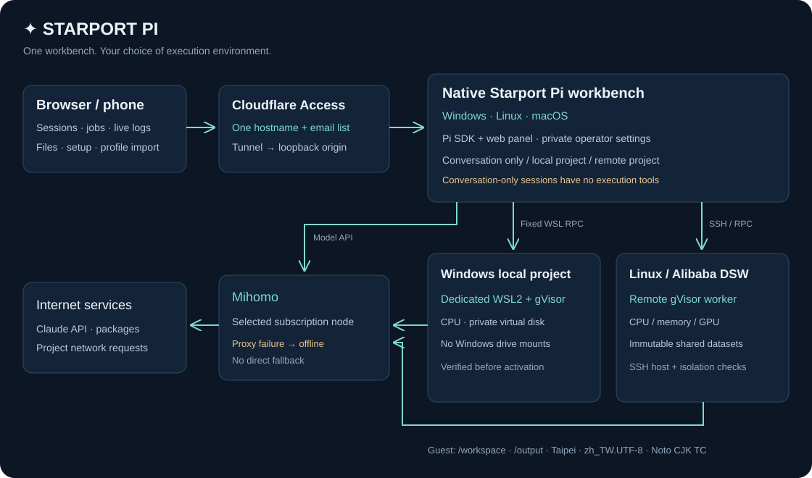

# ✦ Starport Pi

**Windows 原生 Pi 工作台，项目在受控环境中执行。**

使用 Pi SDK 与 Claude API，在网页或终端设置订阅、选择出口、连接服务器、编辑项目和查看任务。纯聊天无需服务器；项目可在远端 Linux 或本机专用 WSL2 + gVisor 中执行。原生面板、纯聊天和远端项目都不需要 WSL2。



| 工作台 | 隔离执行 |
| --- | --- |
| Windows 10/11、Linux、macOS | 远端 Linux／阿里 DSW；Windows x64 本机 CPU |
| Pi SDK、Claude API、模型与 effort 选择 | gVisor 工作区、CPU／内存／GPU 预算 |
| 部署向导、订阅管理、Cloudflare 远端入口 | 项目文件、即时日志、取消、产物下载 |
| 人工选择文件上传，分块续传及 SHA-256 | 发布只读资料版本，按资料 ID 使用 |

## Windows 开始使用

下载或克隆本仓库，在项目目录开启 PowerShell：

```powershell
powershell -ExecutionPolicy Bypass -File .\scripts\install.ps1
```

安装后开启 **http://127.0.0.1:18900/**，使用启动窗口中的访问码登入。

在「部署与管理」完成 **订阅 → 服务器 → 模型 → 远端入口**。贴上 SSH 指令与私钥，或填入 DSW ProxyClient 资讯；核对主机指纹后，系统自动安装隔离环境并验证。Cloudflare Token、网域前缀与信箱名单也可直接在面板设置。

也可导入加密配置后应用出口。模型使用列表选择，界面默认简体中文。

网页提供纯聊天、本机隔离项目和远端项目，以及思考／工具状态、任务、增量日志和文件。手机可透过个别授权的 Tunnel + Access 网址使用。

后续启动：`.\starport-pi.cmd panel`。Linux／macOS：`bash scripts/install.sh`，再执行 `npm run panel`。终端工作台仍可用 `npm start`。

## 执行环境

**Asia/Taipei · zh_TW.UTF-8 · UTF-8 · Noto CJK TC**。每个任务有独立的程序与网路空间，项目位于 `/workspace`，产物位于 `/output`，指定资料位于 `/data/shared/<id>`。没有本机磁碟挂载，也没有模型可呼叫的本机 shell 或设置工具。

模型 API 和任务外网流量经过所选代理；代理中断时不回退直连。SSH／阿里管理通道由操作端单独维护。区域设置决定语言、时间与字形，并不改变服务器实际位置或服务可用地区。

## 指引

- [网页部署向导、密钥与远端访问](docs/REMOTE_ACCESS.md)
- [Agent 安装入口](AGENTS.md) · [安装 Skill](skills/starport-setup/SKILL.md)
- [停用与卸载 Skill](skills/starport-uninstall/SKILL.md)
- [本机隔离项目](docs/LOCAL.md) · [加密配置导入导出](docs/CONFIGURATION.md)
- [完整安装与服务器配置](docs/SETUP.md)
- [操作、文件与共享资料](docs/USAGE.md)
- [隔离边界与资源管理](SECURITY.md)
- [验证范围](docs/VALIDATION.md)

基于 [Pi](https://github.com/earendil-works/pi) 1.4.0 的独立 SDK 工作台；终端保留项目会话和工具事件，配置选单由 Starport 提供。
